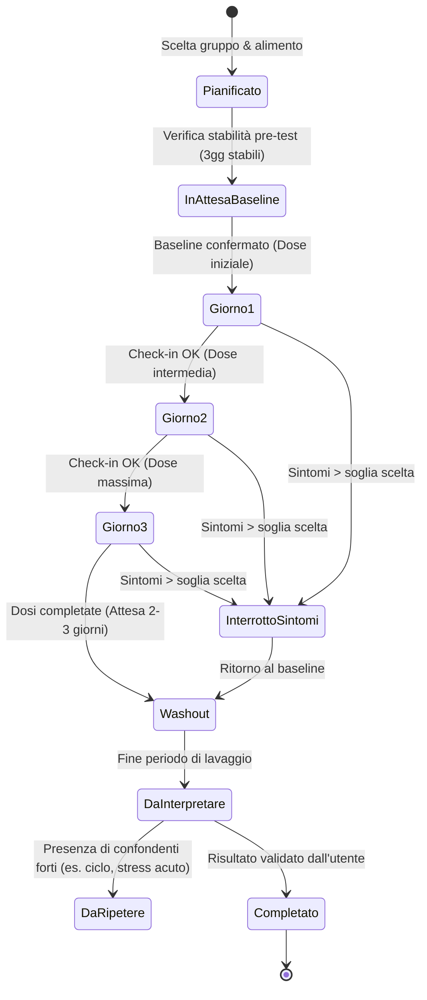

# Specifiche Funzionali — FODMAP Path (Fudy)

---

## 1. Filosofia del Prodotto & Principio Fondamentale

### 1.1 Da "Catalogo di Divieti" a "Mappa Dinamica delle Tolleranze"
La maggior parte delle applicazioni e tabelle FODMAP risponde a una domanda errata:
> ❌ *"Quante volte al giorno o alla settimana posso mangiare questo alimento?"*

La fisiopatologia della sindrome dell'intestino irritabile (IBS) e dei disturbi gastrointestinali dimostra invece che la tolleranza ai FODMAP è **dose-dipendente**, **individuale** e **mutevole nel tempo**. Pertanto, la scheda di un alimento in **FODMAP Path** risponde alle domande corrette:
1. **Quale porzione/quantità esatta è stata consumata?** (in grammi, ml o unità standard).
2. **In quale fase del percorso dietetico ci si trova?** (Baseline, Riduzione/Eliminazione, Reintroduzione o Personalizzazione).
3. **Quale gruppo FODMAP si sta testando o valutando?** (Fruttani, GOS, Lattosio, Fruttosio libero, Sorbitolo, Mannitolo o combinazioni).
4. **Qual è stata la risposta sintomatica soggettiva?**
5. **La risposta è stata confermata da un challenge strutturato?**
6. **Qual è l'attuale porzione massima tollerata senza sintomi invalidanti?**
7. **Può essere combinato con altri alimenti nello stesso pasto?** (carico FODMAP complessivo).
8. **Quando è programmato il prossimo retest?**

### 1.2 Non-Diagnosticità e Limiti di Responsabilità (Disclaimer)
L'applicazione aderisce a rigorosi principi etico-medici:
- **Nessuna diagnosi automatica:** L'app non identifica "il colpevole" né formula diagnosi di intolleranza o patologia.
- **Riconoscimento della complessità:** I sintomi post-prandiali dipendono da pasti misti, svuotamento gastrico, fibre, grassi, stress neuro-enterico, fase ormonale (ciclo mestruale/endometriosi) e farmaci. Una correlazione temporale semplice non equivale a un nesso di causa.
- **Supporto al professionista:** L'app è uno strumento di auto-monitoraggio da affiancare a gastroenterologo, ginecologo e dietista, mai un loro sostituto.
- **Rifiuto della restrizione a vita:** L'app vigila attivamente per prevenire l'iper-restrizione prolungata e incentivare l'allargamento della dieta.

---

## 2. Onboarding Guidato & Baseline Iniziale

### 2.1 Flusso di Primo Avvio
Al primo accesso, l'utente è guidato attraverso una procedura di onboarding in 7 passi:
1. **Fase attuale di partenza:**
   - *Preparazione / Baseline* (raccomandata se non si è ancora iniziato)
   - *Riduzione / Eliminazione attiva* (con inserimento delle settimane già trascorse)
   - *Reintroduzione attiva*
   - *Personalizzazione / Mantenimento*
2. **Obiettivo principale di salute:**
   - Gonfiore / distensione
   - Dolore addominale
   - Regolarità intestinale (diarrea prevalente, stipsi prevalente, alvo alterno)
   - Identificazione sistematica dei trigger alimentari
3. **Diagnosi mediche pregresse (opzionali):**
   - IBS (C, D, M o U secondo criteri Roma IV)
   - Endometriosi (attivazione automatica del modulo dedicato)
   - SIBO o altre condizioni diagnosticate da uno specialista
4. **Restrizioni alimentari indipendenti dai FODMAP:**
   - Celiachia o sensibilità al glutine non celiaca
   - Intolleranza al lattosio diagnosticata (Breath Test)
   - Alimentazione vegetariana / vegana / allergie note (es. nichel, frutta a guscio)
   > *Nota fondamentale:* Filtri "senza glutine" e "senza lattosio" restano logicamente separati dalla categorizzazione FODMAP.
5. **Sintomi iniziali di riferimento (Baseline iniziale):**
   - Intensità media tipica del dolore addominale (0–10) e del gonfiore (0–10).
   - Frequenza abituale dell'alvo e consistenza prevalente (Bristol 1–7).
6. **Farmaci & Integratori correnti:**
   - Lassativi osmotici, procinetici, antispastici, antidiarroici, probiotici, contraccettivi ormonali, FANS.
7. **Livello di dettaglio preferito:**
   - *Tracciamento Rapido* (priorità al check-in in <15 secondi)
   - *Tracciamento Dettagliato* (registrazione estesa con fattori ambientali)

### 2.2 Fase di Preparazione (Baseline Pre-Dieta)
- Durata consigliata: 7–14 giorni prima di eliminare i FODMAP.
- Obiettivo: registrare l'alimentazione abituale senza modifiche intenzionali per quantificare la variabilità spontanea dei sintomi e non attribuire erroneamente al cambio di dieta fluttuazioni naturali.
- Generazione automatica al termine di una **"Fotografia di Baseline"** (media dolore, media gonfiore, stabilità dell'alvo).

---

## 3. Schede Alimenti: Il Modello a 4 Livelli

L'utente ha pieno controllo CRUD (Creazione, Lettura, Modifica, Duplicazione, Archiviazione, Eliminazione) sulle schede alimentari.

### 3.1 Campi della Scheda Alimento
| Campo | Tipo / Opzioni | Descrizione & Scopo |
|---|---|---|
| **Nome & Sinonimi** | Testo | Indicizzazione e ricerca rapida in fase di inserimento pasto. |
| **Categoria** | Enum | Frutta, Verdura, Cereali e Tuberi, Legumi, Latticini/Alternative, Carni/Pesci/Uova, Piatti composti, Condimenti, Snack/Dolci, Bevande. |
| **Porzione di Riferimento** | Quantità + Unità | Grammi (g), Millilitri (ml), Pezzi/Fette, Cucchiai (tbsp/tsp) o "Porzione libera". |
| **Modalità di Preparazione** | Tag multipli | Crudo, Cotto (vapore/bollito/forno), Conservato/Sott'olio, Scolato/Risciacquato (es. legumi in scatola), Fermentato (es. pasta acida). |
| **Gruppo FODMAP Sospetto/Associato** | Multi-select | Fruttani, GOS (Galatto-oligosaccaridi), Lattosio, Fruttosio libero, Sorbitolo, Mannitolo, Multiplo o "Basso FODMAP intrinseco". |
| **Fonte del Dato** | Enum + Note | Inserimento personale, Indicazione del nutrizionista/dietista, Etichetta nutrizionale, Fonte bibliografica esterna (con link facoltativo). *Nessun dato proprietario Monash copiato illegalmente.* |
| **Stato Personale di Tolleranza** | Enum a stati | `NON_PROVATO`, `IN_OSSERVAZIONE`, `DOSE_LIMITATO`, `TOLLERATO_LIBERAMENTE`, `NON_TOLLERATO`. |
| **Porzione Attualmente Tollerata** | Quantità + Unità | La dose massima verificata senza scatenare sintomi sopra il baseline. |
| **Ultimo Test / Challenge** | Data + Esito | Riferimento all'ultimo challenge o osservazione validata. |
| **Livello di Affidabilità** | Enum | *Ipotesi soggettiva* (1 episodio), *Osservazione ripetuta* (≥3 pasti), *Challenge strutturato* (test a 3 dosi completato). |
| **Note Personali** | Testo libero | Marca specifica, ingredienti complessi, tolleranza in combinazione. |

### 3.2 Separazione Concettuale: Dato vs Esperienza vs Regola
La UI della scheda presenta chiaramente 4 blocchi distinti:
1. **Dato Generale / Fonte:** cosa dichiara la confezione o il professionista.
2. **Esperienza Storica:** frequenza di consumo ed episodi sintomatici registrati nei pasti.
3. **Risultato dei Challenge:** riscontro controllato durante la fase di reintroduzione.
4. **Regola Attuale Consigliata:** porzione soglia suggerita per i pasti quotidiani.

---

## 4. Schede Pasti & Immutabilità Storica

### 4.1 Registrazione del Pasto
- **Composizione Multi-Ingrediente:** il pasto è una collezione di porzioni di alimenti singoli o ricette composte.
- **Selezione Rapida:** alimenti frequenti, preferiti e ultimi consumati con ricerca istantanea.
- **Orario Reale di Consumo:** ora esatta (fondamentale per correlare la finestra dei sintomi a 4–8 ore).
- **Tipo di Pasto:** Colazione, Spuntino Mattina, Pranzo, Merenda, Cena, Spuntino Serale / Fuori pasto.
- **Flag "Mangiato Fuori Casa":** evidenzia che ingredienti, condimenti nascosti (aglio/cipolla in polvere) o quantità sono stimati con minore certezza.
- **Flag "Porzione Incompleta / Stimata":** gestione dell'incertezza del dato.
- **Pasti Modello & Duplicazione:** salvataggio di pranzi/cene frequenti e duplicazione rapida con 1 tocco del pasto precedente.

### 4.2 Snapshot Storico (Immutabilità)
> **Principio Architetturale:** Quando un pasto viene registrato, viene salvata una fotografia (*snapshot*) delle proprietà degli alimenti consumati in quell'istante. Se l'utente modifica la scheda "Ceci" 30 giorni dopo, il pasto registrato un mese fa non deve essere alterato retroattivamente, preservando l'integrità del dato clinico.

---

## 5. Check-in Sintomi & Finestra Temporale

### 5.1 Check-in Rapido (< 15 Secondi)
Ideato per scongiurare l'abbandono del diario durante la routine lavorativa:
- **Gonfiore Addominale:** Slider 0–10 con indicatori visuali.
- **Dolore Addominale:** Slider 0–10.
- **Stato Generale Rispetto al Baseline:** `Migliore` | `Uguale` | `Peggiore`.
- **Tasto Rapido "Nessun Sintomo":** azzera immediatamente i valori e registra stabilità con 1 tap.

### 5.2 Check-in Esteso
Attivabile con un tocco quando l'utente avverte alterazioni rilevanti:
- **Distensione visibile:** Sì / No / Marcata.
- **Meteorismo / Flatulenza:** Assente, Lieve, Moderato, Intenso.
- **Dolore Pelvico distinto da Dolore Addominale** (cruciale per endometriosi).
- **Nausea / Senso di pienezza precoce**.
- **Urgenza evacuativa**.
- **Stipsi / Diarrea percepita**.
- **Sensazione di evacuazione incompleta (tenesmo)**.
- **Orario di insorgenza e durata presunta del sintomo**.

---

## 6. Diario dell'Alvo (Bristol Stool Form Scale)

La registrazione dell'alvo è autonoma e disaccoppiata dal check-in dei sintomi:
- **Orario dell'evacuazione**.
- **Tipo Bristol (1–7)** con illustrazioni chiare e descrizioni:
  - *Tipo 1:* Noccioli duri separati, come noci (stipsi severa).
  - *Tipo 2:* A forma di salsiccia, ma formata da grumi (stipsi lieve).
  - *Tipo 3:* Come una salsiccia, con crepe sulla superficie (normale).
  - *Tipo 4:* Come una salsiccia o un serpente, liscia e morbida (normale ideale).
  - *Tipo 5:* Pezzi morbidi con bordi ben delineati (mancanza di fibre / alvo accelerato).
  - *Tipo 6:* Pezzi morbidi con bordi sfrangiati, feci pastose (sub-diarrea).
  - *Tipo 7:* Acquosa, senza pezzi solidi (diarrea).
- **Urgenza:** Assente, Moderata, Incontrollabile.
- **Dolore durante l'evacuazione (Dischezia):** Scala 0–10 (particolare rilevanza per endometriosi profonda o retto-vaginale).
- **Sforzo evacuativo:** Normale, Moderato, Eccessivo.
- **Sensazione di svuotamento incompleto:** Sì / No.
- **Presenza di muco visibile:** Sì / No.

---

## 7. Gestione delle Fasi & Challenge di Reintroduzione

```
+-------------------------------------------------------------------------+
|                         FASI DELLA DIETA LOW-FODMAP                     |
+-------------------------------------------------------------------------+
|                                                                         |
|  [ 0. Baseline ] ---> [ 1. Riduzione ] ---> [ 2. Reintroduzione ]       |
|   (7-14 giorni)       (2-6 settimane)        |   (Challenge strutturati)|
|                                              v                          |
|                                        [ 3. Personalizzazione ]         |
|                                         (Dieta sostenibile nel tempo)   |
|                                         (Retest a 3-6 mesi)             |
+-------------------------------------------------------------------------+
```

### 7.1 Fase 1: Riduzione / Eliminazione
- Tracciamento della durata (giorno `N` dall'avvio).
- Avviso di sicurezza: se la fase supera le 6 settimane senza beneficio evidente, l'app avverte di consultare il professionista anziché restringere ulteriormente la dieta.
- Confronto continuo dei sintomi settimanali con il Baseline.

### 7.2 Macchina a Stati del Challenge di Reintroduzione (3 Dosi)
Un challenge standard prevede la somministrazione di un alimento rappresentativo di uno specifico gruppo FODMAP per 3 giorni a dosi crescenti, mantenendo il resto della dieta strettamente a basso contenuto di FODMAP.



### 7.3 Esito del Challenge (Non Binario)
L'esito non è una semplice etichetta "Promosso/Bocciato":
- `TOLLERATO_ALTA_DOSE`: Nessun sintomo significativo alla dose massima.
- `TOLLERATO_MEDIA_DOSE`: Buona tolleranza alla dose intermedia; sintomi alla dose alta.
- `TOLLERATO_SOLO_INIZIALE`: Tollerata solo una quantità ridotta.
- `SINTOMI_LIEVI_ACCETTABILI`: Lieve meteorismo/distensione ben tollerati dal paziente.
- `SINTOMI_NON_TOLLERATI`: Dolore o alterazione severa dell'alvo (test interrotto).
- `DUBBIO_CONFONDENTI`: Comparsa di mestruazioni, assunzione di FANS o stress acuto durante il challenge (da ripetere).

### 7.4 Fase 3: Personalizzazione & Retest
- Mappa visiva riassuntiva dei 6 gruppi FODMAP (Fruttani da grano, Fruttani da aglio/cipolla, GOS, Lattosio, Fruttosio, Sorbitolo, Mannitolo).
- Scadenzario retest: promemoria a 3–6 mesi per rivalutare gli alimenti dose-limitati o non tollerati, dato che il microbiota e la tolleranza immunitaria/enterica evolvono.

---

## 8. Modulo Endometriosi (Opzionale & Integrato)

Il modulo si attiva su richiesta e previene la classificazione errata di alimenti consumati durante la fase premestruale/mestruale.

### 8.1 Parametri Tracciati
- Giorno del ciclo mestruale o indicazione di amenorrea (indotta da progestinico / ormonoterapia o fisiologica).
- Entità del flusso mestruale: Spotting, Leggero, Medio, Abbondante.
- Terapia ormonale attiva (pillola combinata, solo progestinico, spirale IUD, analoghi GnRH).
- Sintomatologia ginecologica specifica:
  - **Dismenorrea:** dolore crampiforme uterino.
  - **Dolore Pelvico Cronico non mestruale.**
  - **Dispareunia:** dolore durante o dopo i rapporti sessuali.
  - **Dischezia ciclica:** dolore alla defecazione accentuato dal ciclo.
  - **"Endo-belly":** distensione addominale/pelvica improvvisa tipica dell'infiammazione peritoneale.
  - Giorni di lavoro/attività compromessi e assunzione di analgesici.

### 8.2 Logica di Discriminazione Algoritmica
Se un sintomo gastrointestinale compare in concomitanza con la fase mestruale o periovulatoria in presenza di endometriosi accertata, il sistema applica un flag di **"Confondimento Ormonale Probabile"** e genera un avviso prudente:
> *"L'associazione tra questo alimento e il picco di dolore si manifesta prevalentemente durante la fase mestruale. Il dato è attualmente insufficiente per definire l'alimento come trigger dietetico."*

---

## 9. Analisi, Finestre Temporali & Livelli di Evidenza

### 9.1 Finestra Temporale di Analisi (Windowing 4–8 Ore)
I sintomi gastrointestinali correlati alla fermentazione dei FODMAP nel colon si manifestano tipicamente non prima di 2–4 ore dall'ingestione (tempo di transito oro-cecale), protraendosi per 6–12 ore.
- L'algoritmo analizza le correlazioni in finestre configurabili (default: 4 ore post-pasto per sintomi gastrici/piccolo intestino, 6–12 ore per fermentazione colica).
- Pasti inseriti con oltre 6 ore di ritardo vengono contrassegnati come *"Dato a memoria / Certezza temporale ridotta"*.

### 9.2 Livelli di Evidenza Dichiarati
Ogni pattern identificato nel diario viene etichettato con trasparenza:
1. **Osservazione Isolata:** 1 pasto associato a sintomo.
2. **Possibile Associazione:** 2–3 pasti, dati parziali.
3. **Associazione Ripetuta:** ≥ 4 pasti con medesima risposta in assenza di macro-confondenti.
4. **Confondimento Probabile:** Presenza contemporanea di ciclo, stress acuto (score 3/3), alcol, notte insonne o farmaci.
5. **Challenge Strutturato:** Risposta validata durante protocollo controllato di 3 giorni.
6. **Soglia Personale Verificata:** Dose massima confermata in più occasioni.
7. **Da Ritestare:** Risultato anteriore a 6 mesi o contraddittorio.

### 9.3 Registrazione Fattori Confondenti Giornalieri (1-Tap)
- **Stress:** Basso / Medio / Alto.
- **Qualità del sonno:** Riposato / Disturbato / Insonnia.
- **Attività fisica:** Normale / Intensa / Assente.
- **Pasto molto abbondante / grasso:** Sì / No.
- **Alcol o Caffeina in eccesso:** Sì / No.
- **Viaggio / Cambio fuso o orari:** Sì / No.
- **Malattia intercorrente:** (febbre, gastroenterite virale, ecc.).

---

## 10. Sicurezza Clinica & Protezione da Iper-Restrizione

### 10.1 Segnali di Allarme (Red Flags)
L'applicazione effettua un monitoraggio passivo di segnali di allarme clinici che richiedono tempestiva consultazione medica:
- Perdita di peso involontaria e progressiva.
- Sangue visibile nelle feci (rettorragia).
- Vomito persistente.
- Febbre non spiegata associata a sintomi intestinali.
- Risveglio notturno causato da dolore addominale severo o diarrea notturna.
- Peggioramento rapido e progressivo del quadro clinico.
In presenza di questi sintomi, l'app mostra un banner discreto ma chiaro:
> *"Nota di sicurezza: Alcuni sintomi registrati richiedono un approfondimento medico specialistico (gastroenterologo o medico di medicina generale) prima di proseguire con modifiche dietetiche."*

### 10.2 Protezione dall'Iper-Restrizione Alimentare (Check Settimanale)
Ogni 7 giorni l'app propone un rapido check-in di sostenibilità:
- Quante categorie alimentari principali risultano attualmente escluse? (se > 3 gruppi eliminati da oltre 6 settimane -> alert).
- L'utente sta saltando pasti per timore dei sintomi?
- Mangiare fuori casa è diventata fonte di ansia invalidante?
- La dieta genera paura del cibo o senso di colpa?
Se emergono punteggi critici di ortoressia o fobia del cibo, l'app consiglia di arrestare l'inasprimento delle restrizioni e consultare un professionista della nutrizione.

---

## 11. Proprietà Intellettuale & Gestione Dati

- **Nessuna infrazione di copyright:** L'app **non copia né distribuisce** i dati proprietari di Monash University (né tabelle a semaforo proprietarie, né valori misurati in laboratorio estratti dall'app Monash senza licenza).
- **Modello crowdsourced/personale:** Le schede alimentari sono create dall'utente, configurate sulla base di quanto condiviso dal proprio dietista o derivate da etichette commerciali.
- **Catalogo generico di base:** Include unicamente categorie nutrizionali ampie di dominio pubblico (es. "Legumi", "Frutta a granella", "Verdure a foglia") senza attribuzione arbitraria di bollini protetti.
- **Campo fonte obbligatorio:** Ogni informazione inserita esplicita se proviene da test personale, indicazione specialistica o auto-valutazione.
